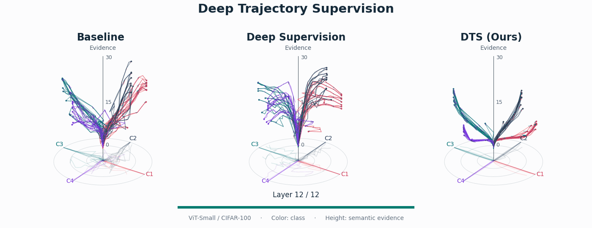

# Deep Trajectory Supervision

**Deep Trajectory Supervision: Deep Supervision Strikes Back — ICML 2026**

Han Wang, Weijie Wang, Jiaqi Liu, Hilde Kuehne, Nicu Sebe

[Paper](https://proceedings.mlr.press/v306/wang26ib.html) · [Training guide](docs/training.md) · [Checkpoints](docs/checkpoints.md) · [Source and validation](docs/provenance.md)

DTS supervises intermediate layers with depth-dependent class probabilities.
For normalized depth $t$, it sets a target logit margin

$$G(t)=G_{\max}\frac{e^{\beta t}-1}{e^\beta-1},\qquad q_t=\mathrm{softmax}(G(t)e_y).$$

Early layers can remain uncertain while deeper layers receive increasingly confident targets.
The ImageNet implementation adds auxiliary classifiers during training; exported DeiT models use only the final classifier at inference.



**Figure 1.** Layer-wise trajectories of ViT-Small on CIFAR-100. Colors denote classes; height shows semantic evidence. Arrows appear as the forward pass progresses through the layers. [Static figure](assets/figure1.png).

## Results

The following results are reported in Tables 2–4 of the [published paper](https://raw.githubusercontent.com/mlresearch/v306/main/assets/wang26ib/wang26ib.pdf). They are the original paper results, not new benchmark runs from the release-validation tests. Accuracy is top-1 (%); gains are percentage points over the terminal-only baseline.

### ImageNet-1K

DTS improves all three DeiT-III model sizes while retaining the baseline inference architecture (Table 3).

| Model | Resolution | Baseline | DTS | Gain |
| --- | --- | ---: | ---: | ---: |
| DeiT-III-T | 224 × 224 | 72.7 | **75.2** | +2.5 |
| DeiT-III-S | 224 × 224 | 80.4 | **81.2** | +0.8 |
| DeiT-III-B | 192 × 192 | 82.3 | **82.6** | +0.3 |

### Additional datasets

Final accuracy at 100% of the training schedule from Table 2. “Deep supervision” applies the same one-hot target at intermediate layers; its results are included where reported. RandAug denotes RandAugment.

| Dataset | Baseline | Deep supervision | DTS | Gain |
| --- | ---: | ---: | ---: | ---: |
| CIFAR-10 | 82.2 | — | **83.9** | +1.7 |
| CIFAR-100 | 54.8 | 55.9 | **57.0** | +2.2 |
| CIFAR-100 + RandAug | 63.5 | 62.9 | **64.1** | +0.6 |
| Tiny-ImageNet | 39.9 | — | **41.9** | +2.0 |
| iNat19 + RandAug | 46.4 | — | **49.1** | +2.7 |

### Training efficiency

Table 4 reports a **3.55%** per-step training overhead for Small and **2.14%** for Base. The time to reach each accuracy threshold includes this overhead. Times below are the paper's measurements, not inference latency.

| Model | Method | Time / step (ms) | Time to 60% (h) | Time to 70% (h) | Time to 80% (h) |
| --- | --- | ---: | ---: | ---: | ---: |
| DeiT-III-S | Baseline | 155.72 | 2.68 | 5.38 | 10.00 |
| DeiT-III-S | DTS | 161.25 | **1.23** | **3.42** | **8.59** |
| DeiT-III-B | Baseline | 277.33 | 2.45 | 4.81 | 12.22 |
| DeiT-III-B | DTS | 283.27 | **2.36** | **4.48** | **12.20** |

## Included code

| Directory | Contents |
| --- | --- |
| `recipes/small_scale/` | ViT training, terminal-only and deep-supervision controls, trajectory measurements |
| `recipes/imagenet_deit/` | DeiT-III training and evaluation, Mixup/CutMix targets, CE/BCE terminal objectives |
| `recipes/probing/` | Frozen-backbone layer probing and trajectory statistics |
| `recipes/imagenet_convnext/` | Archived ConvNeXt extension; uses a different target interpolation, documented in the training guide |
| `configs/` | Explicit training recipes with portable data and output paths |
| `tools/` | Recipe launcher, tensor-only weight export, and image prediction |
| `tests/` | Target/loss checks, gradient tests, entrypoint checks, and export equivalence |

The implementation was recovered from the original research archive. The four DeiT recipes retain their archived launch parameters. The CIFAR presets make the paper's settings explicit; their differences from the archived defaults are recorded in [provenance](docs/provenance.md).

## Installation

Use Python 3.9 or newer. Install a matching PyTorch / torchvision pair for your CUDA version, then:

```bash
git clone https://github.com/Hon-Wong/DTS.git
cd DTS
python -m venv .venv
source .venv/bin/activate
pip install -r requirements.txt
```

Training recipes use NVIDIA GPUs and NCCL. CPU is supported for the tests, DeiT smoke training, and exported DeiT inference. See [validation](docs/provenance.md#validation) for the tested environment.

## Train

Prepare ImageNet as `IMAGENET_ROOT/train/<class>/...` and `IMAGENET_ROOT/val/<class>/...`, with matching class-directory names.

```bash
python tools/train.py --recipe deit_small_dts \
  --data-path /path/to/imagenet --output-dir outputs/deit_small_dts \
  --nproc-per-node 8
```

For CIFAR-100:

```bash
python tools/train.py --recipe cifar100_exponential \
  --data-path /path/to/data --output-dir outputs/cifar100_dts \
  --nproc-per-node 8
```

The launcher supports `--dry-run`. Additional arguments are forwarded to the original entrypoint. Batch size is **per GPU**; changing GPU count changes the global batch size. The [training guide](docs/training.md) covers baselines, fine-tuning, evaluation, probing, and multiple nodes.

## Export and predict

Weights are tracked separately from source code. Current availability is listed in [checkpoints](docs/checkpoints.md).

For a trusted, locally trained DeiT checkpoint:

```bash
python tools/export_weights.py outputs/deit_small_dts/best_checkpoint.pth \
  outputs/deit_small_dts/model.safetensors \
  --trust-checkpoint --deit-inference-only

python tools/predict.py --weights outputs/deit_small_dts/model.safetensors \
  --model deit_small_patch16_LS --input-size 224 --crop-ratio 1.0 \
  --image /path/to/image.jpg
```

Export removes optimizer state and auxiliary heads, and writes a SHA-256 manifest. Prediction uses a strict state-dict load and returns ImageNet class indices and probabilities. Use the checkpoint's architecture and evaluation resolution; the 192-pixel base pretraining checkpoint and the 224-pixel fine-tuned checkpoint are different artifacts.

## Tests

```bash
pip install -r requirements-dev.txt
pytest -q
```

To rebuild the animation from the included figure coordinates:

```bash
python tools/animate_figure1.py
```

## Citation

```bibtex
@inproceedings{pmlr-v306-wang26ib,
  title     = {Deep Trajectory Supervision: Deep Supervision Strikes Back},
  author    = {Wang, Han and Wang, Weijie and Liu, Jiaqi and Kuehne, Hilde and Sebe, Nicu},
  booktitle = {Proceedings of the 43rd International Conference on Machine Learning},
  year      = {2026},
  volume    = {306},
  pages     = {130589--130605},
  publisher = {PMLR},
  url       = {https://proceedings.mlr.press/v306/wang26ib.html}
}
```

## License and acknowledgments

DTS additions and the DeiT-derived code are released under Apache-2.0. The ConvNeXt-derived subtree retains its MIT license. See [LICENSE](LICENSE), [NOTICE](NOTICE), and the subtree licenses. We thank the authors of [DeiT](https://github.com/facebookresearch/deit), [ConvNeXt](https://github.com/facebookresearch/ConvNeXt), and [timm](https://github.com/huggingface/pytorch-image-models).
